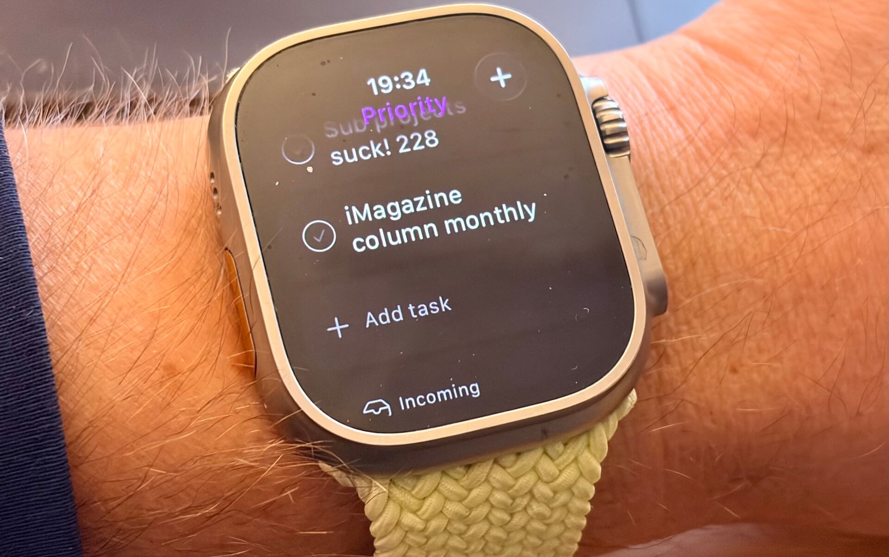
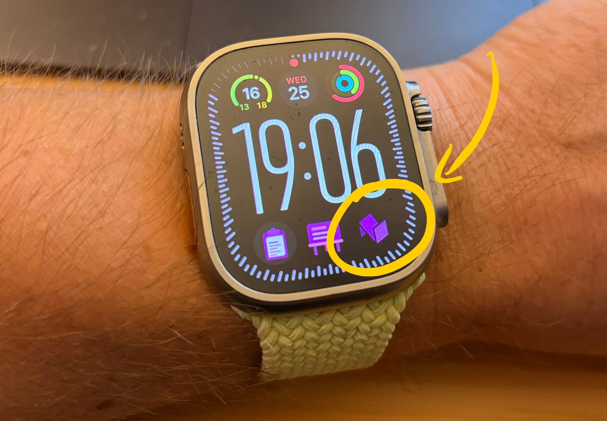

# Getting things done on my wrist - Nozbe for Apple Watch

[Back in the day](/nozbe-watch/) we built a very basic Apple Watch app for **Nozbe Classic** and it was a nice gimmick but I hardly used it. Now that I own an [Apple Watch Ultra](/ultra) and I use its [Action button](/action/) a lot, I was missing a dedicated app on my wrist for [Nozbe][n]. And now it's finally here and you quickly check your priorities, go through a checklist, reply to incoming tasks and comments from your wrist! It's both simple and powerful!



<!--More-->

* TOC
{:toc}

## How to simplify getting things done on a wrist?

In the beginning we set out to build a stripped down mirror of the iPhone app, but very quickly we realized it was too much. Apple Watch is for quick interactions!

### ⭐️ Priority list

We started with a view that doesn't exist on any other device - a list of all priority tasks from all of your workspaces - this way with the Digital Crown you can quickly review all of your priorities and decide on the one to focus on.

### ✅ Quickly add a task

We added a global "➕" button plus a "new task" button below each priority list. This way you can quickly dictate a task on the go and not forget about it.

### 📥 Incoming tasks from each workspace

You can browse incoming tasks if you really don't want to pull up the phone and want to just check what's due or where someone needs your input.

### 💬 Replying to comments with voice or reactions!

For speed, we're not pulling all of a tasks' comments, but only the most recent ones and the pinned ones. This way you get the context and can quickly reply with your voice by speaking to your wrist like James Bond.

[Messages](/messages/) are also supported, so when someone is sending you private communication, you can also privately respond from the wrist!

And if you don't feel like talking, add a quick reaction! 👍

### ☑️ Checking off checklists

When a comment in a task contains a checklist, you can also check off stuff one by one right on the wrist. I find this very satisfying when I'm going shopping and my shopping list is a checklist. This way consulting what to buy next is just a flick of the wrist!

### 📣 Notifications are more interactive!

Now when you're notified about a task on your wrist, you can open it right there and decide what to do next. Add to priority? Delegate further? Add a comment or reaction? Or maybe just complete it?

You have options you've never had before!

## Once I had this app on my wrist, I didn't want to lose it!

Back in the day, an Apple Watch app was a gimmick. Now these watches are much more powerful and such an app makes a difference. We've added a complication so that you can launch your [Nozbe][n] app directly from your watch face.

Many thanks to Tom - Nozbe's CTO - for working together with Claude Code and making this app happen. Once he got the basic version ready, I didn't want to take this app off my wrist.

I must say I also checked our competitors' apps and some were very complicated while others too simple. The "Things" app's simplicity inspired us to go back to the priority list and start from there.

For more details on the new Apple Watch app go to:

### ⌚️ [Nozbe.watch](https://nozbe.com/watch/?c=michaelteam)

We are re-using our old cool ".watch" domain once again!

## 🔗 Bonus: iOS Shortcut to add a task to Nozbe

I've also created a new simple Shortcut that lets you add a task to Nozbe quicker. You can add it to your [Action button](/action) on your Watch Ultra or to your iPhone:

### [Nozbe Task Shortcut][s]

[s]: https://www.icloud.com/shortcuts/e6a92dd36cd04048b0fdc311175330ae

[n]: https://michael.gratis/nozbe
[np]: https://michael.gratis/nozbepersonal